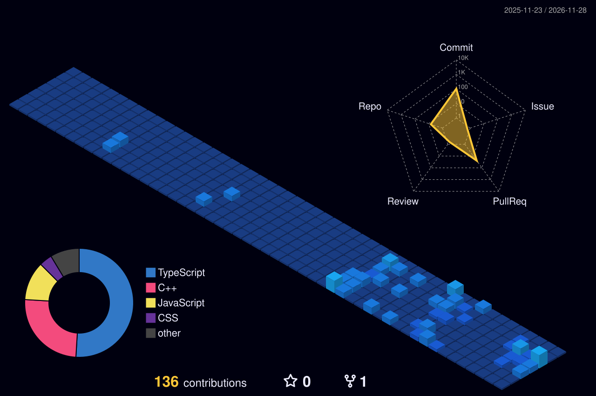

<!-- ═══════════════════════════════════════════════════════════════
     Ashik Khan · GitHub Profile README
     Repo must be named exactly: realashuuu/realashuuu  (public)
     ═══════════════════════════════════════════════════════════════ -->

  

<h2 align="center">🚀 About Me</h2>

  Hey there! I’m Ashik Khan, a Computer Science and Engineering undergraduate and Full Stack Developer focused on building scalable web applications and AI-powered products[cite: 1]. I enjoy turning ideas into practical, reliable software with clean architecture, solid backend systems, and intuitive user experiences.

  I’ve solved 100 LeetCode problems in C++ and work across C++, Python and JavaScript. I’m particularly interested in backend engineering, database design, and real-world LLM integrations alongside core CS fundamentals[cite: 1].

<h2 align="center">🤝 Connect</h2>

  
  
  
  
  

<h2 align="center">💻 Tech Stack</h2>

<table align="center">
  <tr>
    <td align="center" width="96">
       JavaScript
    </td>
    <td align="center" width="96">
       TypeScript
    </td>
    <td align="center" width="96">
       React.js
    </td>
    <td align="center" width="96">
       Next.js
    </td>
    <td align="center" width="96">
       Tailwind CSS
    </td>
    <td align="center" width="96">
       HTML5
    </td>
    <td align="center" width="96">
       CSS3
    </td>
  </tr>
  <tr>
    <td align="center" width="96">
       Node.js
    </td>
    <td align="center" width="96">
       Express.js
    </td>
    <td align="center" width="96">
       PostgreSQL
    </td>
    <td align="center" width="96">
       MongoDB
    </td>
    <td align="center" width="96">
       C
    </td>
    <td align="center" width="96">
       C++
    </td>
    <td align="center" width="96">
       Git
    </td>
  </tr>
  <tr>
    <td align="center" width="96">
       GitHub
    </td>
    <td align="center" width="96">
       VS Code
    </td>
    <td align="center" width="96">
       Vercel
    </td>
    <td align="center" width="96">
       Bootstrap
    </td>
    <td align="center" width="96">
       Linux
    </td>
    <td align="center" width="96">
       ORM / APIs
    </td>
    <td align="center" width="96">
       AI / LLMs
    </td>
  </tr>
</table>

<h2 align="center">📊 Contributions</h2>

  

<h2 align="center">⌘ Commit Activity</h2>

  

 

  

